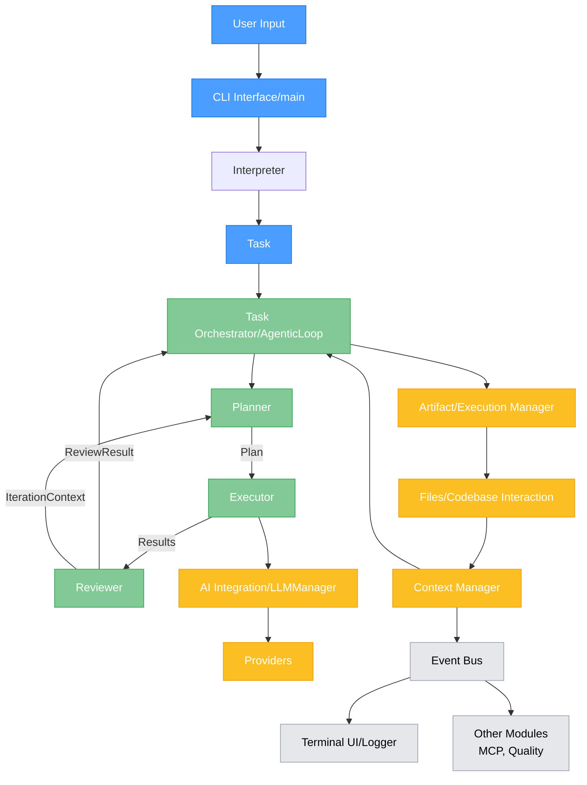

# cli_engineer Architecture Documentation

This document provides a high-level overview of the technical architecture of `cli_engineer`, an experimental autonomous CLI coding agent built in Rust. The system is designed around an agentic loop that facilitates planning, execution, and review cycles to complete software engineering tasks. It is a non-interactive CLI tool that leverages AI to automate coding tasks, manages artifacts (e.g., code files, execution outputs), executes code in isolated environments, installs dependencies, maintains an artifact manifest, and provides a colorful terminal display with real-time feedback. The tool is designed for fully automated execution, relying on initial commands and configurations without requiring user interaction.

## Core Philosophy

The architecture is modular and event-driven, centered around a core `AgenticLoop`. Components are designed to be loosely coupled, communicating primarily through an `EventBus`. This allows for flexible UI implementations and clear separation of concerns. Emphasis is placed on modularity, extensibility, safety, and automation.

## System Overview

`cli_engineer` operates as a Rust-based CLI tool that automates software engineering workflows. It starts with user input via CLI flags or TOML configuration files, interprets tasks, gathers context, plans and executes steps using AI, reviews outputs, and iterates as needed. It supports interactions with various LLM providers, manages codebases intelligently, handles artifacts securely, and provides visual feedback through a terminal UI.

## Key Components

The application is composed of several key modules and functional components, each with distinct responsibilities. Below is a synthesized list that combines module-level details with functional roles:

1. **CLI Interface (`main.rs` and UI Modules)**  
   - **Purpose**: Serves as the application's entry point and provides user-facing interfaces.  
   - **Responsibilities**:  
     - Handles command-line argument parsing (using `clap`), sets up configuration, initializes the UI (`DashboardUI` or `EnhancedUI`), and delegates tasks.  
     - Accepts input via CLI flags or TOML files.  
     - Displays outputs, including the artifact manifest, execution results, progress bars (via `indicatif`), and real-time metrics using ANSI escape codes.  
     - Offers real-time, in-place updating terminal dashboard (`DashboardUI`) or traditional scrolling output with progress bars (`EnhancedUI`). Both listen to the `EventBus` for updates.

2. **Task Orchestrator (`AgenticLoop`)**  
   - **Purpose**: Orchestrates the entire workflow, managing iterative cycles of planning, execution, and review.  
   - **Responsibilities**:  
     - Coordinates automated workflows based on initial input and configurations.  
     - Iteratively calls the Planner, Executor, and Reviewer until the task is complete or maximum iterations are reached.  
     - Manages parallel tasks using `tokio`, synthesizes results, and prioritizes based on configuration or estimated impact.  
     - Emits events for progress, completion, and metrics to the `EventBus`.

3. **Interpreter**  
   - **Purpose**: Translates raw user input into structured tasks.  
   - **Responsibilities**:  
     - Takes initial user prompts and converts them into a clear `Task` with defined goals. This is the first step in understanding user intent.

4. **Planner**  
   - **Purpose**: Generates detailed plans for tasks.  
   - **Responsibilities**:  
     - Receives a `Task` and `IterationContext`, uses an LLM to create a step-by-step `Plan`.  
     - Adapts plans based on previous results and feedback for iterative refinement.

5. **Executor**  
   - **Purpose**: Carries out planned steps.  
   - **Responsibilities**:  
     - Executes each `Step` in the `Plan`, often prompting the LLM to generate code or content.  
     - Saves generated artifacts via the Artifact Manager.  
     - Handles code execution in isolated environments, including dependency installation.

6. **Reviewer**  
   - **Purpose**: Assesses execution results for quality and completeness.  
   - **Responsibilities**:  
     - Analyzes artifacts using an LLM to identify issues, check correctness, and determine if goals are met.  
     - Produces a `ReviewResult` with issues and assessments, triggering iterations if needed.

7. **AI Integration Layer (`LLMManager`)**  
   - **Purpose**: Manages interactions with AI providers.  
   - **Responsibilities**:  
     - Abstracts support for providers like OpenAI, Anthropic, Gemini, xAI, OpenRouter, Ollama.  
     - Selects providers based on configuration, handles prompts and responses.  
     - Switches between reasoning, non-reasoning, and visual models.  
     - Tracks API costs, optimizes prompts for code queries, and emits metrics.

8. **Codebase Interaction Module**  
   - **Purpose**: Enables intelligent interaction with the codebase.  
   - **Responsibilities**:  
     - Performs AI-driven semantic searches, fuzzy matching, and cross-file analysis.  
     - Executes shell commands (e.g., `ls`, `cat`, `grep`, `find`) and captures outputs.  
     - Supports automated file operations (CRUD) with AI validation.

9. **Artifact and Execution Manager (`ArtifactManager`)**  
   - **Purpose**: Handles artifact lifecycle and code execution.  
   - **Responsibilities**:  
     - Creates, updates, and stores files in designated directories.  
     - Sets up isolated environments (e.g., virtualenv, containers), installs dependencies via AI detection.  
     - Maintains a JSON manifest with metadata (name, type, location, creation time, purpose).  
     - Validates artifacts (syntax checks, linting), generates execution plans, and emits events.

10. **Context Manager (`ContextManager`)**  
    - **Purpose**: Maintains and optimizes context for LLMs.  
    - **Responsibilities**:  
      - Gathers relevant source files, conversation history, and codebase context.  
      - Monitors context window limits, compresses via summarization at 50% usage.  
      - Caches snippets, handles summarization/compression, and emits usage metrics.

11. **MCP and Visual Analysis Module**  
    - **Purpose**: Integrates with external tools for visual and web data processing.  
    - **Responsibilities**:  
      - Acts as an MCP client (e.g., for Playwright UI screenshots).  
      - Analyzes images with visual LLMs.  
      - Retrieves web content for documentation or APIs.

12. **Quality and Collaboration Module**  
    - **Purpose**: Ensures code quality and supports external integrations.  
    - **Responsibilities**:  
      - Performs AI-driven semantic linting and refactoring suggestions.  
      - Integrates with GitHub for issues and pull requests.

13. **Event Bus (`EventBus`)**  
    - **Purpose**: Facilitates decoupled communication.  
    - **Responsibilities**:  
      - Asynchronous publish-subscribe system for events between components, UI, and loggers.

## The Agentic Workflow and Key Flows

The primary workflow follows an iterative "Plan-Execute-Review" cycle managed by the `AgenticLoop` and Task Orchestrator.

1. **Interpretation**: User's prompt is translated into a structured `Task`.
2. **Context Gathering**: Scan directory for relevant files and build context.
3. **Planning**: Generate a step-by-step `Plan` using LLM, considering prior feedback.
4. **Execution**: Execute steps, generate/save artifacts, install dependencies, and run code in isolation.
5. **Review**: Assess results, identify issues, and decide on completion or iteration.
6. **Iteration**: Update context with feedback and repeat if needed, up to `max_iterations`.

### Artifact Management Flow
1. Task Orchestrator initiates based on commands/config.
2. Artifact Manager sets up environment, executes, validates, updates manifest, and emits events.
3. Terminal UI displays progress and manifest.

### Terminal Display Mechanism
1. Components emit events to Event Bus (e.g., context usage, API costs).
2. Terminal UI renders color-coded sections, progress bars, metrics, and manifest summary.

## Architectural Diagram

The following diagram illustrates the flow of control and data between major components.

## Technologies
- Language: Rust
- CLI Framework: `clap`
- Async Programming: `tokio`
- HTTP Client: `reqwest`
- Serialization: `serde`
- Terminal UI: `indicatif` for progress bars, custom ANSI rendering
- Testing: `cargo test`

## Design Principles
- Modularity: Components interact via the Event Bus for loose coupling.
- Extensibility: Easy to add providers, tools, or modules.
- Safety: Isolated execution environments and Rust’s memory safety.
- Automation: Executes tasks without user intervention based on initial input.
- Efficiency: Context optimization, parallel task handling, and real-time feedback.